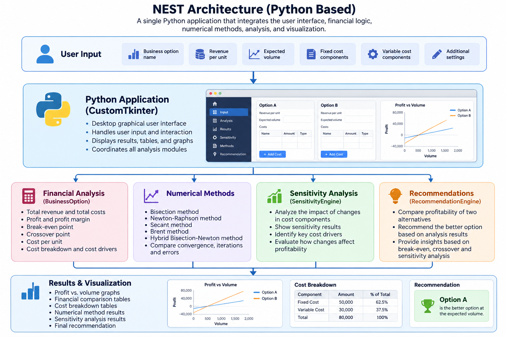

# NEST — Numerical Evaluation for Strategic Tradeoffs

NEST is a Python-based desktop application designed to help users compare two business alternatives using financial analysis, numerical methods, and interactive data visualization.

The application evaluates profitability, identifies break-even and crossover points, analyzes cost structures, and generates recommendations to support business decisions.

## Features

### Financial Analysis
- Calculate total revenue, total costs, and profit.
- Compare two business alternatives at their expected sales volumes.
- Calculate profit margins and cost per unit.
- Identify break-even and crossover points.

### Cost Analysis
- Add multiple fixed and variable cost components.
- Categorize costs by type, such as labor, materials, transport, and overhead.
- Identify major cost drivers.
- Analyze how changes in individual costs affect profitability.

### Numerical Methods

NEST implements five root-finding methods:

- Bisection
- Newton-Raphson
- Secant
- Brent
- Hybrid Bisection-Newton

These methods are used to solve break-even, crossover, and other numerical equations.

The application also allows users to compare numerical methods based on their convergence results, iteration counts, and errors.

### Data Visualization
- Profit-versus-volume graphs
- Financial comparison summaries
- Cost breakdown tables
- Sensitivity analysis results
- Numerical method comparisons

### Business Recommendations

NEST compares the profitability of two alternatives and generates recommendations based on expected sales volumes, break-even points, crossover points, and cost drivers.

## Technologies Used

- **Python** — Application logic and financial calculations
- **CustomTkinter** — Desktop graphical user interface
- **NumPy** — Numerical calculations
- **Matplotlib** — Data visualization
- **Pillow** — Image handling
- **PyInstaller** — Windows executable packaging

## How to Run

### Option 1 — Run the Windows Application

1. Download [NEST.exe](https://github.com/victoriazakarian/NEST/raw/refs/heads/main/NEST.exe).
2. Open the executable on Windows.
3. Enter the financial data for two business alternatives.
4. Run the analysis to view calculations, graphs, and recommendations.

No Python installation is required to run the packaged Windows application.

*Note: Windows SmartScreen may display a warning because the executable is not digitally signed.*

### Option 2 — Run from Python Source

Install the required libraries:

```bash
pip install customtkinter numpy matplotlib pillow
```

Run the application:

```bash
python nest.py
```

## Project Structure

```text
NEST/
├── nest.py        # Python application source code
├── NEST.exe       # Packaged Windows application
├── assets/        # Project images and architecture
└── README.md      # Project documentation
```
## Architecture

NEST is built entirely in Python, integrating financial analysis, numerical methods, sensitivity analysis, and data visualization into one desktop application.

### Architecture Diagram



## How NEST Works

1. The user enters revenue, expected sales volume, and cost information for two business alternatives.
2. Python calculates financial indicators for each alternative.
3. Numerical methods identify break-even and crossover points.
4. Sensitivity analysis evaluates the impact of changing costs.
5. Matplotlib generates visualizations.
6. The application displays a comparison and recommendation.

## Project Purpose

NEST was developed to combine programming, numerical analysis, financial modeling, and data visualization in a practical decision-support application.

The project demonstrates the use of Python to transform business inputs into meaningful analytical results.
